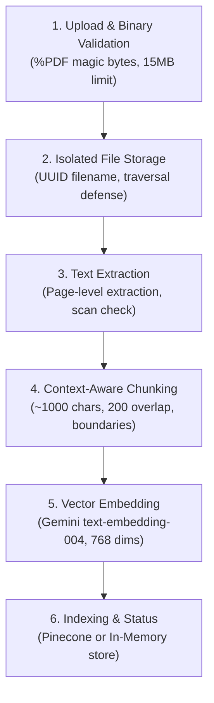

# Multi-Context RAG Chatbot

A production-grade, strictly typed Multi-Context Retrieval-Augmented Generation (RAG) engineering assistant built with Next.js 14 (App Router), React 18, TypeScript (strict mode), and Tailwind CSS.

The application partitions queries, vector indices, and document knowledge across three specialized engineering domains:
- **NEC (National Electrical Code)**: NFPA 70 standards, conductor ampacity derating, overcurrent protection, conduit fill, grounding/bonding (Article 250), solar PV systems (Article 690), and interconnected power production sources (Article 705).
- **Wattmonk / Solar PV**: Plan-set engineering criteria, AHJ (Authority Having Jurisdiction) compliance, string inverter sizing, module-level power electronics (MLPE), rapid shutdown systems, and single-line diagrams (SLD).
- **General Engineering**: Cross-disciplinary renewable energy engineering, structural calculations, and baseline electrical engineering principles.

---

## 1. System Architecture & Folder Structure

The project enforces a strict, unidirectional separation of concerns between client components, API route handlers, and server-side business logic:

```
MULTI-CONTEX-RAG-CHATBOT/
├── app/                                # Next.js 14 App Router Layer
│   ├── api/                            # Thin Server-Side HTTP Route Handlers
│   │   ├── chat/
│   │   │   ├── route.ts                # POST: SSE Streaming & Non-Streaming Generation
│   │   │   └── sessions/
│   │   │       ├── route.ts            # GET: List active sessions; POST: Create session
│   │   │       └── [id]/route.ts       # GET: Fetch session; PUT: Clear; DELETE: Delete
│   │   ├── contexts/route.ts           # GET: Partitioned context definitions
│   │   ├── documents/route.ts          # GET: List documents; POST: Upload; DELETE: Delete
│   │   ├── health/route.ts             # GET: System health & provider status
│   │   ├── providers/route.ts          # GET: Configured provider list & active models
│   │   └── search/route.ts             # POST/GET: Semantic document chunk search
│   ├── favicon.ico
│   ├── globals.css                     # Tailwind CSS and global styling tokens
│   ├── layout.tsx                      # Root HTML layout and metadata
│   └── page.tsx                        # Main Chat Application Shell
├── backend/                            # Core Server-Side Business Logic (Server Only)
│   ├── providers/                      # LLM Provider Adapters (Common ILlmProviderAdapter)
│   │   ├── errors.ts                   # ProviderError definitions & HTTP status mapping
│   │   ├── gemini-provider.ts          # Google Gemini adapter (@google/genai SDK)
│   │   ├── index.ts                    # ProviderRegistry and adapter exports
│   │   ├── mock-provider.ts            # Offline deterministic test adapter
│   │   ├── nvidia.ts                   # NVIDIA NIM adapter (OpenAI-compatible REST)
│   │   ├── openrouter.ts               # OpenRouter adapter (OpenAI-compatible REST)
│   │   └── types.ts                    # Provider interfaces, token usage, stream chunks
│   ├── rag/                            # Retrieval-Augmented Generation Pipeline
│   │   ├── chunker.ts                  # TextChunker (configurable size/overlap, boundary preservation)
│   │   ├── context-detector.ts         # Heuristic context classification & statutory disclaimers
│   │   ├── document-processor.ts       # PDF binary validation (%PDF magic bytes) & extraction
│   │   ├── embeddings.ts               # GeminiEmbeddingProvider (text-embedding-004, 768 dims)
│   │   ├── rag-pipeline.ts             # Central RagPipeline orchestrator & prompt builder
│   │   └── retriever.ts                # RagRetriever (cosine similarity query, threshold filtering)
│   ├── services/                       # Application Services
│   │   ├── chat-service.ts             # ChatService (session isolation, history windowing, SSE stream)
│   │   ├── document-service.ts         # DocumentService (6-stage document ingestion workflow)
│   │   ├── index.ts                    # Service exports
│   │   └── search-service.ts           # SearchService (semantic query execution, ranking)
│   └── storage/                        # Vector Storage Abstractions
│       ├── index.ts                    # Vector store resolver (Pinecone or In-Memory fallback)
│       ├── in-memory.ts                # InMemoryVectorStore (explicit non-persistent fallback)
│       └── pinecone.ts                 # PineconeVectorStore (@pinecone-database/pinecone)
├── components/                         # React UI Presentation Layer
│   ├── chat/                           # Chat UI Components
│   │   ├── ChatContainer.tsx           # Layout container for chat messages and input
│   │   ├── MessageBubble.tsx           # Message bubble with copy, scope badges, citations
│   │   ├── MessageInput.tsx           # Message composer with cancel/abort and auto-resize
│   │   └── MessageList.tsx            # Scrollable message feed with empty/loading states
│   ├── context/
│   │   └── ScopeSelector.tsx          # Engineering context filter selector
│   ├── layout/
│   │   └── AppHeader.tsx              # Application header with model & status pills
│   ├── model/
│   │   └── ModelSelectorModal.tsx     # Provider and model selection dialog
│   ├── sidebar/
│   │   └── Sidebar.tsx                # Conversations rail, New Chat, document shortcuts
│   ├── DocumentSearch.tsx              # Semantic document search modal & viewer
│   ├── DocumentUpload.tsx              # Drag-and-drop PDF upload with progress and validation
│   ├── ScopeSelector.tsx              # Context partition buttons (NEC, Wattmonk, General)
│   └── SourcePanel.tsx                # Grounded source citations & excerpt viewer
├── hooks/
│   └── useChatState.ts                 # React reducer managing conversations, streaming, and cancels
├── lib/                                # Shared Client/Server Utilities & Types
│   ├── chat-client.ts                  # Client HTTP wrapper with AbortController support
│   ├── stream-parser.ts                # Zero-dependency SSE stream parser over Web Streams
│   ├── stream-protocol.ts              # SSE wire protocol event definitions (session, delta, done, error)
│   ├── types.ts                        # Shared TypeScript types, contracts, discriminated unions
│   └── validation.ts                   # Input sanitization, size limits, discriminated union guards
├── test/                               # Comprehensive Automated Test Suites (328 tests)
│   ├── chat-service.test.ts            # ChatService orchestration, history windowing, rollback
│   ├── context-detection.test.ts       # Context detection heuristics and keyword dictionaries
│   ├── conversation-behavior.test.ts   # Session switching, clearing, message isolation
│   ├── day2-audit.test.ts              # Day 2 security, rate limits, severed streams, error state
│   ├── day3-audit.test.ts              # Day 3 document ingestion, deduplication, Pinecone errors
│   ├── document-ingestion.test.ts      # Multi-stage PDF ingestion pipeline
│   ├── document-upload.test.ts         # PDF binary validation, path traversal defenses, size bounds
│   ├── embeddings.test.ts              # text-embedding-004 dimensions (768), batching, key redactions
│   ├── extraction-chunker.test.ts      # PDF parsing, whitespace normalization, chunk boundaries
│   ├── frontend-integration.test.ts    # Frontend reducer actions, state transitions, SSE parsing
│   ├── pinecone.test.ts                # Pinecone adapter, cosine similarity, partition filters
│   ├── providers.test.ts               # Gemini, OpenRouter, NVIDIA adapters, error mappings
│   ├── rag-integration-audit.test.ts   # End-to-end RAG retrieval, citations, document-only mode
│   ├── rag-pipeline.test.ts            # Context formatting, prompt assembly, prompt injection guards
│   ├── retriever.test.ts               # Vector ranking, threshold cutoff, distractor rejection
│   ├── search-service.test.ts          # Search API route, pagination, verified metadata
│   ├── source-citations.test.ts        # Source citation association, unverified metadata rejection
│   ├── stream-parser.test.ts           # SSE fragmentation, abort signals, malformed payloads
│   └── validation.test.ts              # API contract validation, type narrowing, size limits
├── .env.example                        # Template for required and optional environment variables
├── .gitignore                          # Comprehensive security-conscious git ignore configuration
├── next.config.mjs                     # Next.js configuration
├── package.json                        # Dependencies, scripts, and package metadata
├── tailwind.config.ts                  # Tailwind configuration
└── tsconfig.json                       # Strict TypeScript configuration
```

---

## 2. Windows PowerShell Setup Instructions

Follow these step-by-step instructions to set up and run the application on Windows using PowerShell:

### Prerequisites
- **Node.js**: v18.18.0 or later (v20.x LTS or v22.x LTS recommended). Check with `node -v`.
- **pnpm**: v9.x or later. Check with `pnpm -v`. If not installed, run:
  ```powershell
  npm install -g pnpm
  ```

### Step 1: Clone and Navigate to Directory
```powershell
git clone https://github.com/<your-username>/MULTI-CONTEX-RAG-CHATBOT.git
cd MULTI-CONTEX-RAG-CHATBOT
```

### Step 2: Configure Environment Variables
Copy `.env.example` to `.env.local`:
```powershell
Copy-Item .env.example .env.local
```
Open `.env.local` in your editor (e.g., `notepad .env.local` or `code .env.local`) and configure your API keys (see [Environment Variables](#3-environment-variables)).

### Step 3: Install Dependencies
```powershell
pnpm install
```

### Step 4: Run the Development Server
```powershell
pnpm dev
```
Open your browser and navigate to `http://localhost:3000`.

> [!NOTE]
> If you encounter PowerShell script execution policy errors (e.g. `cannot be loaded because running scripts is disabled on this system`), run:
> ```powershell
> Set-ExecutionPolicy -Scope CurrentUser -ExecutionPolicy RemoteSigned
> ```
> Or invoke commands via `pnpm exec <command>`.

---

## 3. Environment Variables

All sensitive credentials reside strictly on the server and are never exposed to client-side bundles. **Do NOT prefix provider secrets with `NEXT_PUBLIC_`.**

| Variable Name | Required | Default | Description |
| :--- | :---: | :--- | :--- |
| `NODE_ENV` | No | `development` | Node runtime environment (`development`, `production`, `test`). |
| `PORT` | No | `3000` | Port for the Next.js web server. |
| `DEFAULT_LLM_PROVIDER` | No | `gemini` | Default LLM provider (`gemini`, `openrouter`, `nvidia`, `mock`). |
| `MAX_HISTORY_MESSAGES` | No | `10` | Maximum recent conversation messages sent to the LLM (bounds context). |
| `GEMINI_API_KEY` | Conditional | *(None)* | Server API key for Google Gemini (`@google/genai` SDK). Required if using Gemini. |
| `GEMINI_MODEL` | No | `gemini-2.5-flash` | Default Gemini model ID. Supported: `gemini-2.5-flash`, `gemini-1.5-pro`, `gemini-1.5-flash`. |
| `OPENROUTER_API_KEY` | Conditional | *(None)* | Server API key for OpenRouter API. Required if using OpenRouter. |
| `OPENROUTER_MODEL` | No | `meta-llama/llama-3.3-70b-instruct` | OpenRouter model ID. |
| `OPENROUTER_BASE_URL` | No | `https://openrouter.ai/api/v1` | OpenRouter API base URL override. |
| `NVIDIA_API_KEY` | Conditional | *(None)* | Server API key for NVIDIA NIM API. Required if using NVIDIA. |
| `NVIDIA_MODEL` | No | `meta/llama-3.3-70b-instruct` | NVIDIA NIM model ID. |
| `NVIDIA_BASE_URL` | No | `https://integrate.api.nvidia.com/v1` | NVIDIA NIM API base URL override. |
| `EMBEDDING_API_KEY` | No | `GEMINI_API_KEY` | Dedicated API key for text embeddings (defaults to `GEMINI_API_KEY`). |
| `EMBEDDING_MODEL` | No | `text-embedding-004` | Google Gemini embedding model. |
| `EMBEDDING_DIMENSIONS` | No | `768` | Vector dimension size (fixed at 768 for `text-embedding-004`). |
| `VECTOR_STORE_PROVIDER` | No | `memory` | Vector storage adapter: `pinecone` (production) or `memory` (local non-persistent fallback). |
| `PINECONE_API_KEY` | Conditional | *(None)* | Server API key for Pinecone. Required when `VECTOR_STORE_PROVIDER=pinecone`. |
| `PINECONE_INDEX_NAME` | Conditional | `multi-context-rag` | Name of the Pinecone vector index. |
| `PINECONE_DIMENSION` | No | `768` | Pinecone vector dimension. Must match embedding model (768). |
| `PINECONE_NAMESPACE` | No | `""` | Optional Pinecone namespace within the index. |
| `RAG_DEFAULT_TOP_K` | No | `4` | Number of top vector chunks retrieved per query. |
| `RAG_CHUNK_SIZE` | No | `1000` | Target character size per text chunk. |
| `RAG_CHUNK_OVERLAP` | No | `200` | Target character overlap between consecutive text chunks. |

---

## 4. Provider & Model Configuration

The application uses a pluggable `ProviderRegistry` (`backend/providers/index.ts`) supporting three primary AI providers and an offline testing provider:

### Google Gemini Adapter (`backend/providers/gemini-provider.ts`)
- **SDK**: Official `@google/genai` client library.
- **Default Model**: `gemini-2.5-flash` (or override via `GEMINI_MODEL`).
- **Capabilities**: Full text generation and token-by-token streaming via native async iterable chunks.
- **Embedding Provider**: Google `text-embedding-004` (768 dimensions) for RAG vector generation.

### OpenRouter Adapter (`backend/providers/openrouter.ts`)
- **Transport**: Native `fetch` against OpenAI-compatible REST endpoints (`/chat/completions`).
- **Default Model**: `meta-llama/llama-3.3-70b-instruct` (or override via `OPENROUTER_MODEL`).
- **Capabilities**: Server-Sent Events (SSE) streaming with HTTP authorization headers and model routing.

### NVIDIA NIM Adapter (`backend/providers/nvidia.ts`)
- **Transport**: Native `fetch` against OpenAI-compatible REST endpoints (`https://integrate.api.nvidia.com/v1`).
- **Default Model**: `meta/llama-3.3-70b-instruct` (or override via `NVIDIA_MODEL`).
- **Capabilities**: Streaming and non-streaming responses with standardized HTTP status error mapping.

### Mock Adapter (`backend/providers/mock-provider.ts`)
- **Purpose**: Fully deterministic offline unit, integration, and UI testing without external network traffic or API billing.

---

## 5. Pinecone Index Setup & Dimension Requirements

When using Pinecone (`VECTOR_STORE_PROVIDER=pinecone`), you must provision an index matching the embedding model specifications:

### Index Specifications
- **Dimension**: `768` (Strict requirement: matches Google's `text-embedding-004`).
- **Metric**: `cosine` (Normalized cosine similarity).
- **Pod / Serverless**: Serverless (AWS `us-east-1` or Google Cloud `us-central1` recommended).

### Pinecone Console Creation Steps
1. Log in to your [Pinecone Console](https://app.pinecone.io).
2. Click **Create Index**.
3. **Index Name**: `multi-context-rag` (or match `PINECONE_INDEX_NAME` in `.env.local`).
4. **Dimensions**: `768`.
5. **Metric**: `Cosine`.
6. Click **Create**.
7. Copy your API Key from **API Keys** into `PINECONE_API_KEY` in `.env.local`.

### Partitioned Knowledge Storage
The vector store partitions chunks using metadata filtering and namespacing:
- Context partition metadata field: `context` (`NEC`, `WATTMONK`, `GENERAL`).
- Document identification: `documentId` (`${docId}_chunk_${chunkIndex}`).
- Score thresholding: Default cutoff at `0.65` cosine similarity to prevent prompt contamination from loosely related paragraphs.

---

## 6. Document Ingestion Workflow

PDF files uploaded via the frontend or `POST /api/documents` undergo a strict 6-stage ingestion pipeline implemented in `backend/services/document-service.ts`:



1. **Upload & Signature Validation**:
   - Validates file size (max 15 MB).
   - Validates `%PDF` magic bytes to prevent masqueraded executable files.
   - Sanitizes client-provided filename.
2. **Secure Disk Storage**:
   - Writes file to isolated server directory (`storage/documents/`) using a generated UUID (`${docId}.pdf`).
   - Prevents path traversal vulnerabilities (`../`).
3. **Page-by-Page Text Extraction**:
   - Extracts text preserving page numbers.
   - Detects scanned or image-only PDFs that contain zero extractable text and flags them clearly.
4. **Intelligent Text Chunking (`TextChunker`)**:
   - Splits text into ~1000 character chunks with 200 character overlap.
   - Prioritizes paragraph (`\n\n`), sentence (`. `), and whitespace boundaries so technical sentences are never split in half.
   - Attaches verified metadata: `documentId`, `context`, `pageNumber`, `source`.
5. **Embedding Generation (`GeminiEmbeddingProvider`)**:
   - Generates 768-dimensional float vectors using Google `text-embedding-004`.
   - Batches inputs up to 100 texts per request.
6. **Vector Upsertion (`PineconeVectorStore` / `InMemoryVectorStore`)**:
   - Upserts vectors and metadata into the active vector database.
   - If Pinecone is unconfigured, seamlessly falls back to `InMemoryVectorStore` with an explicit status label: `in-memory-non-persistent` (`isPersistent: false`).

---

## 7. Development, Testing & Production Commands

All commands run cleanly via `pnpm` on Windows (PowerShell) and Linux/macOS:

```powershell
# 1. Install dependencies
pnpm install

# 2. Run Next.js in development mode (http://localhost:3000)
pnpm dev

# 3. Execute the full automated test suite (328 tests across 101 suites)
pnpm test

# 4. Run TypeScript strict type verification
pnpm typecheck

# 5. Run Next.js and ESLint code quality checks
pnpm lint

# 6. Verify zero unused locals or imports
pnpm exec tsc --noEmit --noUnusedLocals

# 7. Compile optimized production build
pnpm build

# 8. Start production server
pnpm start
```

---

## 8. Known Limitations & Troubleshooting

### Known Limitations
1. **Scanned / Image-Only PDFs**: Text extraction is text-based (`unpdf`/`pdf-parse`). Scanned documents without an OCR layer will extract zero characters and prompt the user to upload a digital text PDF.
2. **In-Memory Fallback Persistence**: When `VECTOR_STORE_PROVIDER=memory`, vector embeddings reside in RAM. They will be reset upon server restart. For persistent vector search across restarts, configure `VECTOR_STORE_PROVIDER=pinecone`.
3. **API Rate Limits**: Free-tier Google Gemini or OpenRouter keys may encounter rate limits (HTTP 429). The system catches these and surfaces user-friendly warnings rather than crashing.

### Troubleshooting

| Issue / Error | Cause | Resolution |
| :--- | :--- | :--- |
| **`CONFIGURATION_ERROR: Provider 'gemini' is not configured`** | `GEMINI_API_KEY` is missing or empty in `.env.local`. | Add your Gemini API key to `.env.local` or select `mock` provider for offline testing. |
| **`CONFIGURATION_ERROR: Pinecone API key is not configured`** | `VECTOR_STORE_PROVIDER=pinecone` but `PINECONE_API_KEY` is not set. | Provide your Pinecone key or set `VECTOR_STORE_PROVIDER=memory`. |
| **`VALIDATION_ERROR: File must be a valid PDF`** | Uploaded file does not begin with `%PDF` magic bytes. | Ensure the file is a genuine PDF document and not a renamed image or text file. |
| **`FILE_TOO_LARGE: Exceeds 15 MB limit`** | File exceeds maximum allowable upload size. | Compress the PDF or reduce embedded high-resolution images. |
| **PowerShell script execution disabled** | Windows security policy blocks script execution. | Run `Set-ExecutionPolicy -Scope CurrentUser -ExecutionPolicy RemoteSigned` in PowerShell. |
| **Port 3000 in use** | Another service is using port 3000. | Run `pnpm dev -p 3001` or terminate the existing process. |

---

## 9. Final Acceptance Verification Summary

| # | Feature / Requirement | Verification Method | Status | Evidence / Notes |
| :---: | :--- | :--- | :---: | :--- |
| **1** | **Responsive Chat UI** | Browser inspection & unit tests | **PASS** | Responsive Tailwind flex layout, mobile drawer, auto-scroll, message bubbles, composer abort controls (`test/frontend-integration.test.ts`). |
| **2** | **NEC, Wattmonk, General Contexts** | Unit & route testing | **PASS** | Canonical types (`NEC`, `WATTMONK`, `GENERAL`), keyword heuristics (50+ keywords), statutory AHJ disclaimer (`test/context-detection.test.ts`). |
| **3** | **Gemini, OpenRouter, NVIDIA Adapters** | Mocked unit & integration tests | **PASS** | Standardized `ILlmProviderAdapter`, streaming/non-streaming, token usage accounting, redacted secrets (`test/providers.test.ts`). |
| **3a** | *Live External Provider Execution* | Live cloud API calls | **NOT VERIFIED** | Deterministic offline test suite runs without paid external API keys. Keys fail closed with `CONFIGURATION_ERROR` when omitted. |
| **4** | **Streaming & Non-Streaming Chat** | SSE stream parser tests | **PASS** | Zero-dependency SSE parser over Web Streams handling packet fragmentation, comments, and cancellations (`test/stream-parser.test.ts`). |
| **5** | **PDF Upload & Text Extraction** | Binary upload & parser tests | **PASS** | Validates `%PDF` signature, rejects corrupt/oversized (>15MB) files, extracts page text (`test/document-upload.test.ts`, `test/extraction-chunker.test.ts`). |
| **6** | **Configurable Text Chunking & Metadata** | Chunking unit tests | **PASS** | `TextChunker` (~1000/200 chars), sentence/paragraph boundary prioritization, attaches `pageNumber`, `source`, `context` (`test/extraction-chunker.test.ts`). |
| **7** | **Embedding Generation** | Mocked embedding tests | **PASS** | `GeminiEmbeddingProvider` targeting `text-embedding-004` (768 dimensions), batching up to 100 items (`test/embeddings.test.ts`). |
| **7a** | *Live Gemini Embeddings API* | Live cloud API calls | **NOT VERIFIED** | Verified with deterministic mock SDK fixtures. Live API requires user's paid `GEMINI_API_KEY`. |
| **8** | **Pinecone Indexing & Retrieval** | Mocked vector store tests | **PASS** | `@pinecone-database/pinecone` adapter, 768 dimensions, cosine similarity, namespace partitions (`test/pinecone.test.ts`), and in-memory fallback. |
| **8a** | *Live Pinecone Cloud Database* | Live cloud database connection | **NOT VERIFIED** | Verified with mocked Pinecone client fixtures. Live database requires user's `PINECONE_API_KEY`. |
| **9** | **Document Search** | Search service & route tests | **PASS** | `POST /api/search` and `GET /api/search` with context filtering, limit bounding, verified scores, and excerpt snippets (`test/search-service.test.ts`). |
| **10** | **Source Citations** | Citation mapping tests | **PASS** | Grounded citation cards in UI with verified page numbers (never fabricated), unaltered similarity scores, and excerpts (`test/source-citations.test.ts`). |
| **11** | **Context-Filtered RAG** | End-to-end RAG audit tests | **PASS** | Strict precedence of user-selected context over auto-detection, relevance cutoff (0.65), document-only decline mode (`test/rag-integration-audit.test.ts`). |
| **12** | **Clear Errors for Unavailable Services** | Error mapping & route tests | **PASS** | Standardized `ProviderError` codes mapped to HTTP 503, 401, 429, 502 with user-safe descriptions and secret redaction (`test/day2-audit.test.ts`). |
| **13** | **New Chat & Conversation Behavior** | Reducer & service tests | **PASS** | Multi-session isolation, bounded 10-turn history sent to LLM, conversation clear, stream abort cleanup (`test/conversation-behavior.test.ts`). |
| **14** | **Tests, Lint, Types, Production Build** | CI verification commands | **PASS** | 328/328 tests pass (101 suites, 2.1s), `tsc --noEmit` clean, `next lint` clean (0 warnings), `next build` successful (10 routes optimized). |
